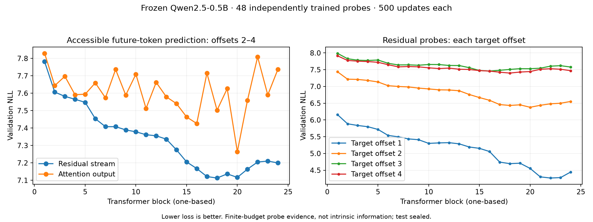
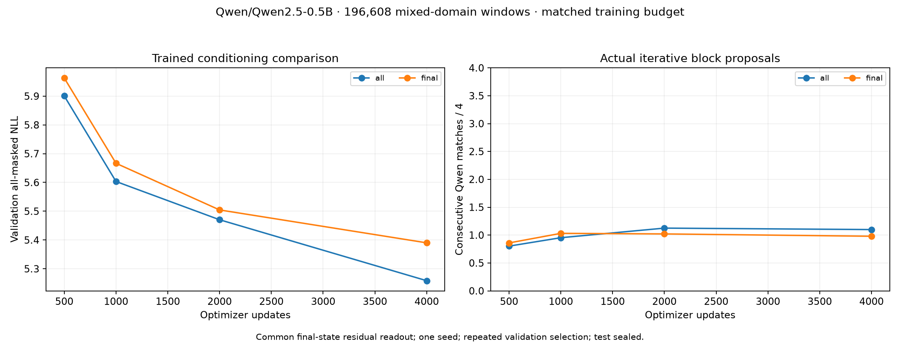

# Trained conditioning comparison

Same 196k training windows and 192 validation windows; test metrics sealed.
Decoder comparisons share a final-state residual shortcut. Probe ranking
uses no such shortcut. All-masked loss is not sequence likelihood.

| Condition | Best update | NLL | Prose | Code | Translation | Qwen prefix / 4 |
| --- | ---: | ---: | ---: | ---: | ---: | ---: |
| conditioning-all-01 | 4000 | 5.259 | 5.437 | 4.888 | 5.450 | 1.099 |
| conditioning-final-01 | 4000 | 5.390 | 5.605 | 4.989 | 5.576 | 0.979 |

Best checkpoints are selected by validation NLL within each run.
This exploratory ranking does not establish generalization to new source
groups, significance across many layer choices, or useful generation quality.
Raw JSON/JSON.gz preserves model/corpus/source revisions, per-example metrics
and checkpoint provenance. See ../docs/conditioning-study.md for the protocol.
